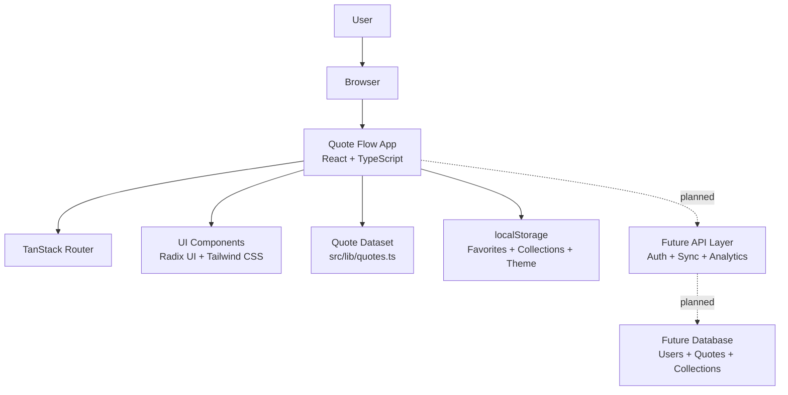
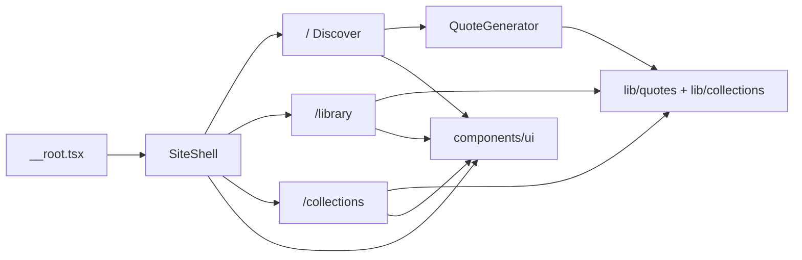
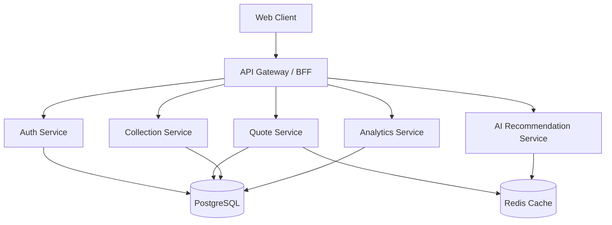
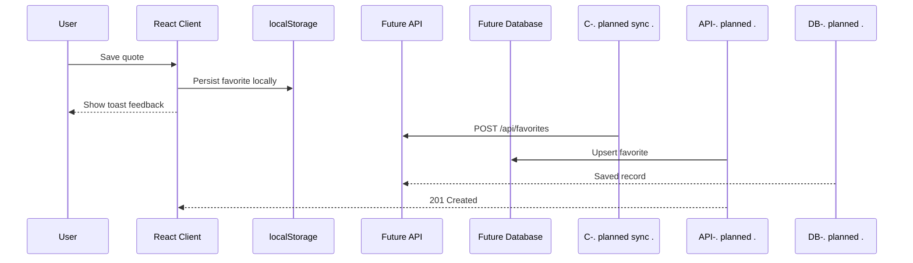
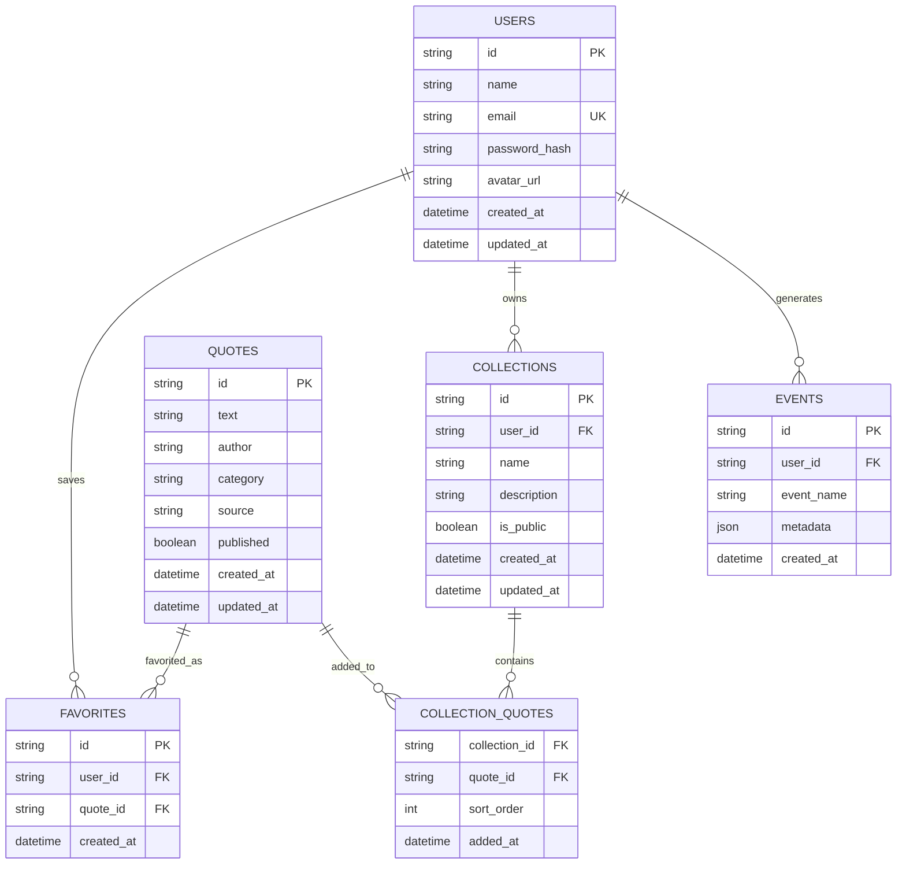
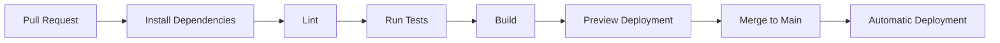

<div align="center">

<!-- Replace this placeholder with your hosted logo or repo asset. -->


# Quote Flow

### Curated inspiration, beautifully organized.

Quote Flow is a polished, local-first quote workspace for discovering meaningful ideas, saving favorites, and organizing inspiration into personal collections.

<br />

[](https://github.com/nsaiashish135/QuoteFlow/stargazers)
[](#-license)
[](#-roadmap)
[](#-cicd-pipeline)
[](#-deployment-guide)

[](https://react.dev/)
[](https://www.typescriptlang.org/)
[](https://vite.dev/)
[](https://tanstack.com/start)
[](https://tailwindcss.com/)
[](https://www.radix-ui.com/)

<br />

<a href="#-overview">Overview</a>
 ·
<a href="#-features">Features</a>
 ·
<a href="#-architecture">Architecture</a>
 ·
<a href="#-installation">Installation</a>
 ·
<a href="#-deployment-guide">Deployment</a>

</div>

---

## 📌 Overview

Quote Flow solves a simple but common problem: inspiration is easy to find, but hard to keep organized. The app gives users a focused place to browse curated quotes, filter by mood or category, save what resonates, and group ideas into collections for later use.

It exists as a lightweight, portfolio-ready SaaS-style product experience that demonstrates modern frontend architecture, refined interaction design, responsive UI patterns, local-first persistence, and a clean path toward future cloud sync, authentication, analytics, and AI recommendations.

| Dimension | Details |
| --- | --- |
| **Problem** | Quotes and ideas are scattered across screenshots, notes, bookmarks, and social feeds. |
| **Solution** | A dedicated quote workspace with discovery, favorites, search, categories, and collections. |
| **Target users** | Creators, writers, students, founders, designers, coaches, and productivity-focused professionals. |
| **Business value** | Demonstrates a polished consumer SaaS foundation with room for subscriptions, cloud sync, team libraries, and AI personalization. |
| **Current model** | Local-first app using browser storage; no account or database required for core usage. |

### Real-World Use Cases

- Build a personal inspiration library for writing, journaling, design, or presentations.
- Save motivational quotes for daily routines, coaching sessions, and team rituals.
- Organize quotes by topic, campaign, project, mood, or creative direction.
- Use as a foundation for a SaaS inspiration platform with auth, analytics, sync, and AI discovery.

---

## ✨ Features

### Feature Showcase

| Category | Feature | Description | Status |
| --- | --- | --- | --- |
| **Core** | Quote discovery | Shuffle through a curated dataset of quotes across motivation, success, life, wisdom, creativity, and mindfulness. | ✅ Available |
| **Core** | Category filters | Narrow quote discovery by topic using responsive filter chips. | ✅ Available |
| **Core** | Searchable library | Search quotes by text or author from the full library page. | ✅ Available |
| **Core** | Favorites | Save meaningful quotes in persistent browser storage. | ✅ Available |
| **Advanced** | Collections | Create, rename, delete, and manage custom quote collections. | ✅ Available |
| **Advanced** | Share and copy | Copy quotes to the clipboard or use native Web Share when available. | ✅ Available |
| **Advanced** | Theme support | Light and dark modes with stored user preference. | ✅ Available |
| **AI** | Smart recommendations | Personalized quote suggestions by mood, intent, or writing context. | 🧭 Planned |
| **Admin** | Content management | Admin-managed quote moderation, tagging, and publishing workflows. | 🧭 Planned |
| **Analytics** | Usage insights | Track popular categories, saved quotes, collection growth, and engagement. | 🧭 Planned |
| **Security** | Auth and account sync | JWT/OAuth account support for private cloud-synced libraries. | 🧭 Planned |
| **Performance** | Fast local UX | Static quote dataset, route-level structure, and lightweight browser persistence. | ✅ Available |

<details>
<summary><strong>More Product Highlights</strong></summary>

- Responsive desktop, tablet, and mobile layouts.
- Keyboard shortcut support for quote generation.
- Accessible UI primitives powered by Radix UI.
- Toast feedback for favorite, copy, collection, and create actions.
- Clean separation between route screens, UI components, data helpers, and app shell.

</details>

---

## 🖼️ Screenshots

> Replace these placeholders with screenshots from your deployed app or `/docs/screenshots` assets.

| Landing Page | Dashboard / Discover |
| --- | --- |
|  |  |

| Admin Panel | Analytics | Mobile View |
| --- | --- | --- |
|  |  |  |

---

## 🏗️ Architecture

Quote Flow is currently a modern frontend application with local persistence. The architecture is intentionally simple today and ready to evolve into a full-stack SaaS product with authentication, APIs, database persistence, analytics, and AI services.

### System Architecture Overview



### Frontend Architecture



### Backend Architecture

The current project does not require a backend for the shipped user experience. A production SaaS backend can be added with this planned shape:



### Database Architecture

Today, favorites and collections live in `localStorage`. For cloud sync, the planned database design includes users, quotes, favorites, collections, and collection items.

### API Flow



---

## 🧰 Technology Stack

| Category | Technologies |
| --- | --- |
| **Frontend** |   |
| **Routing / App Runtime** |   |
| **Styling** |   |
| **Components** |   |
| **Icons / Feedback** |   |
| **Build Tooling** |    |
| **Persistence** | Browser `localStorage` for favorites, collections, and theme preference |
| **Planned Backend** | Node.js, PostgreSQL, Redis, JWT/OAuth, analytics pipeline |
| **Deployment** | Vercel, Netlify, Railway, Render, AWS, Docker |

---

## 📁 Folder Structure

```txt
QuoteFlow/
├── src/
│   ├── components/
│   │   ├── QuoteGenerator.tsx
│   │   ├── SiteShell.tsx
│   │   └── ui/
│   ├── hooks/
│   ├── lib/
│   │   ├── api/
│   │   ├── collections.ts
│   │   ├── quotes.ts
│   │   └── utils.ts
│   ├── routes/
│   │   ├── __root.tsx
│   │   ├── index.tsx
│   │   ├── library.tsx
│   │   └── collections.tsx
│   ├── router.tsx
│   ├── routeTree.gen.ts
│   ├── server.ts
│   ├── start.ts
│   └── styles.css
├── components.json
├── eslint.config.js
├── package.json
├── tsconfig.json
└── vite.config.ts
```

| Path | Purpose |
| --- | --- |
| `src/components` | Feature components and global layout shell. |
| `src/components/ui` | Reusable UI primitives generated in the shadcn/Radix style. |
| `src/hooks` | Shared React hooks such as responsive viewport detection. |
| `src/lib` | Quote data, collection persistence helpers, config, and utilities. |
| `src/lib/api` | Placeholder for future server/API functions. |
| `src/routes` | File-based route screens for Discover, Library, and Collections. |
| `src/styles.css` | Global styles, tokens, animations, and Tailwind CSS setup. |
| `vite.config.ts` | Vite and TanStack plugin configuration. |

---

## 🚀 Installation

### Prerequisites

- Node.js 18 or newer
- npm 9 or newer
- Git

### 1. Clone the Repository

```bash
git clone https://github.com/nsaiashish135/QuoteFlow.git
cd QuoteFlow
```

### 2. Install Dependencies

```bash
npm install
```

### 3. Configure Environment Variables

Core usage does not require environment variables. You can create a local file for future configuration:

```bash
touch .env.local
```

Example:

```env
VITE_APP_NAME="Quote Flow"
VITE_APP_ENV="development"

# Planned backend values
DATABASE_URL=""
JWT_SECRET=""
OAUTH_CLIENT_ID=""
OAUTH_CLIENT_SECRET=""
```

### 4. Database Setup

No database is required for the current version. Favorites, collections, and theme preferences are stored locally in the browser.

For the planned cloud-sync version:

```bash
# Example future commands
npm run db:migrate
npm run db:seed
```

### 5. Run the Development Server

```bash
npm run dev
```

Open:

```txt
http://localhost:5173
```

### 6. Build for Production

```bash
npm run build
npm run preview
```

### Available Scripts

| Command | Description |
| --- | --- |
| `npm run dev` | Start the local Vite development server. |
| `npm run build` | Create a production build. |
| `npm run build:dev` | Build using development mode. |
| `npm run preview` | Preview the production build locally. |
| `npm run lint` | Run ESLint checks. |
| `npm run format` | Format files with Prettier. |

---

## 📚 API Documentation

Quote Flow currently ships as a local-first frontend app. The API below documents the planned production contract for cloud accounts, syncing, admin workflows, and analytics.

### Authentication APIs

| Method | Endpoint | Description |
| --- | --- | --- |
| `POST` | `/api/auth/register` | Create a new user account. |
| `POST` | `/api/auth/login` | Authenticate with email and password. |
| `POST` | `/api/auth/oauth` | Authenticate with an OAuth provider. |
| `POST` | `/api/auth/refresh` | Refresh an access token. |
| `POST` | `/api/auth/logout` | Invalidate the active session. |

Request:

```json
{
  "email": "user@example.com",
  "password": "strong-password"
}
```

Response:

```json
{
  "user": {
    "id": "usr_123",
    "name": "Alex Morgan",
    "email": "user@example.com"
  },
  "accessToken": "jwt-access-token",
  "refreshToken": "jwt-refresh-token"
}
```

### User APIs

| Method | Endpoint | Description |
| --- | --- | --- |
| `GET` | `/api/users/me` | Return the authenticated profile. |
| `PATCH` | `/api/users/me` | Update profile preferences. |
| `DELETE` | `/api/users/me` | Delete the user account. |

### Project / Quote APIs

| Method | Endpoint | Description |
| --- | --- | --- |
| `GET` | `/api/quotes` | List quotes with category, author, and search filters. |
| `GET` | `/api/quotes/:id` | Return a single quote. |
| `POST` | `/api/favorites` | Save a quote as a favorite. |
| `DELETE` | `/api/favorites/:quoteId` | Remove a favorite quote. |
| `GET` | `/api/collections` | List user collections. |
| `POST` | `/api/collections` | Create a collection. |
| `PATCH` | `/api/collections/:id` | Rename or update a collection. |
| `DELETE` | `/api/collections/:id` | Delete a collection. |

Example collection request:

```json
{
  "name": "Leadership Notes",
  "quoteIds": ["1", "7", "12"]
}
```

Example response:

```json
{
  "id": "col_123",
  "name": "Leadership Notes",
  "quoteIds": ["1", "7", "12"],
  "createdAt": "2026-06-21T07:30:00.000Z",
  "updatedAt": "2026-06-21T07:30:00.000Z"
}
```

### Admin APIs

| Method | Endpoint | Description |
| --- | --- | --- |
| `GET` | `/api/admin/quotes` | List all quotes with moderation metadata. |
| `POST` | `/api/admin/quotes` | Create a new quote. |
| `PATCH` | `/api/admin/quotes/:id` | Update quote text, author, or category. |
| `DELETE` | `/api/admin/quotes/:id` | Archive or delete a quote. |
| `GET` | `/api/admin/analytics` | Retrieve platform usage metrics. |

### Status Codes

| Code | Meaning |
| --- | --- |
| `200` | Successful request. |
| `201` | Resource created. |
| `400` | Invalid request payload. |
| `401` | Missing or invalid authentication. |
| `403` | Insufficient permissions. |
| `404` | Resource not found. |
| `409` | Conflicting resource state. |
| `429` | Rate limit exceeded. |
| `500` | Unexpected server error. |

---

## 🗄️ Database Schema

Current persistence uses browser `localStorage`:

| Key | Value |
| --- | --- |
| `qg:favorites` | Array of saved quote IDs. |
| `qg:collections` | Array of collection objects with `id`, `name`, `quoteIds`, and `createdAt`. |
| `qg:theme` | User theme preference: `light` or `dark`. |

### Planned Entity Relationship Diagram



### Planned Constraints

| Table | Constraint |
| --- | --- |
| `users` | Unique email, required password hash for password auth. |
| `quotes` | Required text, author, category, and moderation status. |
| `favorites` | Unique pair of `user_id` and `quote_id`. |
| `collections` | Collection names scoped to a user. |
| `collection_quotes` | Composite primary key on `collection_id` and `quote_id`. |
| `events` | Indexed by `user_id`, `event_name`, and `created_at`. |

---

## 🔐 Security Features

| Security Area | Current / Planned Approach |
| --- | --- |
| **JWT Authentication** | Planned for account-based cloud sync and API authorization. |
| **OAuth** | Planned support for GitHub, Google, or other identity providers. |
| **Password Encryption** | Planned password hashing with bcrypt/Argon2; no plaintext credentials. |
| **Rate Limiting** | Planned API throttling for auth, quote creation, and analytics endpoints. |
| **CORS Protection** | Planned allowlist-based CORS configuration for production APIs. |
| **Input Validation** | Planned Zod validation for request bodies, params, and query strings. |
| **SQL Injection Prevention** | Planned parameterized queries through a safe ORM/query builder. |
| **XSS Protection** | React escaping, controlled rendering, strict validation, and sanitized admin input. |
| **Local Data Privacy** | Current user data stays in the user's browser unless future sync is enabled. |

---

## ⚡ Performance Optimizations

- **Lazy loading:** Route-based structure supports progressive loading as the app grows.
- **Code splitting:** Vite and route boundaries keep production bundles efficient.
- **Caching:** Static quote data loads instantly; future APIs can use HTTP cache headers and Redis.
- **CDN support:** Production assets can be served through Vercel, Netlify, CloudFront, or another CDN.
- **Query optimization:** Planned indexed database tables for quote search, favorites, and analytics.
- **Image optimization:** Screenshot and brand assets should be compressed and served in modern formats.
- **Local-first responsiveness:** Favorites and collections update immediately without network latency.

---

## 🚢 Deployment Guide

### Vercel

```bash
npm install
npm run build
```

Recommended settings:

| Setting | Value |
| --- | --- |
| Framework Preset | Vite / Other |
| Build Command | `npm run build` |
| Output Directory | `dist` |
| Install Command | `npm install` |

### Netlify

```bash
npm run build
```

Recommended settings:

```txt
Build command: npm run build
Publish directory: dist
```

### Railway

```bash
npm install
npm run build
npm run preview
```

Use Railway when adding a backend, database, or long-running service.

### Render

```txt
Build Command: npm install && npm run build
Start Command: npm run preview
```

### AWS

Recommended options:

- **S3 + CloudFront** for static hosting.
- **Amplify Hosting** for Git-based frontend deployments.
- **ECS / App Runner** for containerized full-stack deployments.

### Docker

Use Docker when deploying to container-first platforms or when the app gains backend services.

---

## 🐳 Docker Support

### Docker Setup

```dockerfile
FROM node:22-alpine AS deps
WORKDIR /app
COPY package*.json ./
RUN npm ci

FROM node:22-alpine AS builder
WORKDIR /app
COPY --from=deps /app/node_modules ./node_modules
COPY . .
RUN npm run build

FROM node:22-alpine AS runner
WORKDIR /app
COPY --from=builder /app/dist ./dist
RUN npm install -g serve
EXPOSE 3000
CMD ["serve", "-s", "dist", "-l", "3000"]
```

### Docker Compose

```yaml
services:
  quote-flow:
    build: .
    ports:
      - "3000:3000"
    environment:
      - NODE_ENV=production
```

### Production Deployment

```bash
docker build -t quote-flow .
docker run -p 3000:3000 quote-flow
```

---

## 🔄 CI/CD Pipeline

### GitHub Actions

```yaml
name: CI

on:
  push:
    branches: [main]
  pull_request:
    branches: [main]

jobs:
  quality:
    runs-on: ubuntu-latest
    steps:
      - uses: actions/checkout@v4
      - uses: actions/setup-node@v4
        with:
          node-version: 22
          cache: npm
      - run: npm ci
      - run: npm run lint
      - run: npm run build
```

### Workflow Diagram



---

## 🧪 Testing

The current repository includes linting and production build validation. As the app grows, add unit, integration, and E2E coverage around quote selection, persistence, collection management, and navigation.

| Test Type | Recommended Tooling | Example Command |
| --- | --- | --- |
| **Linting** | ESLint | `npm run lint` |
| **Build Verification** | Vite | `npm run build` |
| **Unit Testing** | Vitest + React Testing Library | `npm run test` |
| **Integration Testing** | Vitest + Testing Library | `npm run test:integration` |
| **E2E Testing** | Playwright | `npm run test:e2e` |
| **Coverage Reports** | Vitest coverage | `npm run test:coverage` |

Suggested future test coverage:

- Quote filtering and randomization behavior.
- Favorite save/remove flows.
- Collection create, rename, delete, and quote assignment flows.
- Theme persistence.
- Responsive navigation and keyboard accessibility.

---

## 🗺️ Roadmap

- [x] Phase 1: Curated quote discovery experience
- [x] Phase 2: Favorites, library search, categories, and collections
- [x] Phase 3: Responsive polished UI with light/dark theme
- [ ] Phase 4: Real screenshot assets and hosted demo URL
- [ ] Phase 5: Unit, integration, and E2E test suite
- [ ] Phase 6: Authentication and cloud sync
- [ ] Phase 7: Admin quote management
- [ ] Phase 8: Analytics dashboard
- [ ] Phase 9: AI-powered recommendations
- [ ] Phase 10: Mobile app / PWA experience

---

## 🔮 Future Enhancements

- AI-powered quote recommendations based on mood, topic, journal prompts, or writing context.
- Advanced analytics for most-saved quotes, category trends, and user engagement.
- Automation workflows for daily quote delivery through email, Slack, or push notifications.
- Mobile app and PWA support with offline caching.
- Real-time shared collections for teams, classrooms, and communities.
- Multi-tenancy for organizations, coaches, creators, and content teams.
- SaaS features such as billing, account tiers, invite links, public profiles, and branded collections.
- Admin dashboard for quote moderation, imports, tagging, and publishing workflows.

---

## 🤝 Contributing

Contributions are welcome and appreciated.

### Contribution Workflow

1. Fork the repository.
2. Create a feature branch:

```bash
git checkout -b feature/your-feature-name
```

3. Install dependencies:

```bash
npm install
```

4. Make your changes and validate them:

```bash
npm run lint
npm run build
```

5. Commit using a clear message:

```bash
git commit -m "feat: add quote collection export"
```

6. Push your branch and open a pull request:

```bash
git push origin feature/your-feature-name
```

### Pull Request Guidelines

- Keep changes focused and easy to review.
- Include screenshots for UI changes.
- Add or update tests when behavior changes.
- Update documentation when adding features, commands, or configuration.

---

## 📄 License

This project is licensed under the MIT License.

You are free to use, modify, and distribute this project in accordance with the license terms. Add a `LICENSE` file to the repository if one is not already present.

---

## 🆘 Support

| Channel | Link |
| --- | --- |
| **Documentation** | Use this README as the primary setup and architecture guide. |
| **Issues** | [Open an issue](https://github.com/nsaiashish135/QuoteFlow/issues) for bugs or feature requests. |
| **Discussions** | [Start a discussion](https://github.com/nsaiashish135/QuoteFlow/discussions) for ideas, questions, and roadmap feedback. |
| **Email Support** | Add your support email here. |

---

## 🙏 Acknowledgements

- React, TypeScript, Vite, TanStack, Tailwind CSS, Radix UI, Lucide, and the open-source ecosystem.
- Contributors and reviewers who improve the product, docs, and developer experience.
- Writers, thinkers, designers, and builders who inspired the quote-centered experience.

---

<div align="center">

### Built with ❤️ by [@nsaiashish135](https://github.com/nsaiashish135)

⭐ Star this repository if you found it useful.

<br />

<strong>Quote Flow</strong> · Curated inspiration for focused minds.

</div>
